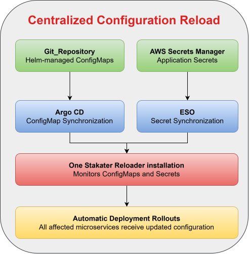

# Reloader Complete Flow  
#   
<div align="center">
  <h2>Reloader Complete Flow</h2>
  
</div>
## Helm Deployment  
```yaml
apiVersion: apps/v1
kind: Deployment
metadata:
  name: backend
  namespace: shopverse-dev

  annotations:
    reloader.stakater.com/auto: "true"

spec:
  replicas: 3

  strategy:
    type: RollingUpdate
    rollingUpdate:
      maxUnavailable: 0
      maxSurge: 1

  selector:
    matchLabels:
      app: backend

  template:
    metadata:
      labels:
        app: backend

    spec:
      containers:
        - name: backend
          image: backend:v1

          envFrom:
            - configMapRef:
                name: backend-config

            - secretRef:
                name: backend-secret
```
## Configure Reloader for Argo CD
Your Reloader Helm values:  
```yaml
reloader:
  reloadStrategy: annotations
```
And configure Argo CD to ignore Reloader's generated annotation:  
```yaml
spec:
  ignoreDifferences:
    - group: apps
      kind: Deployment
      jsonPointers:
        - /spec/template/metadata/annotations/reloader.stakater.com~1last-reloaded-from
```
## One important consideration  
When using this approach, remember:  

Configuration change  	     What happens  
ConfigMap changes in Git	   Argo CD syncs it, Reloader triggers rollout  
Secret changes in AWS	       ESO syncs it, Reloader triggers rollout  
Unrelated ConfigMap changes	 Only workloads referencing that ConfigMap should be affected  
Unrelated Secret changes	   Only workloads referencing that Secret should be affected  

Also, ensure Argo CD doesn't undo Reloader's generated annotation, and test the interaction between annotation reloads and your Argo CD sync settings.  

My final recommendation: Use Reloader for both ConfigMaps and Secrets, with reloader.stakater.com/auto: "true". Remove Helm checksum annotations.  

This gives you one centralized configuration-reload mechanism across all your Shopverse microservices, with less Helm template complexity and less operational overhead.  
